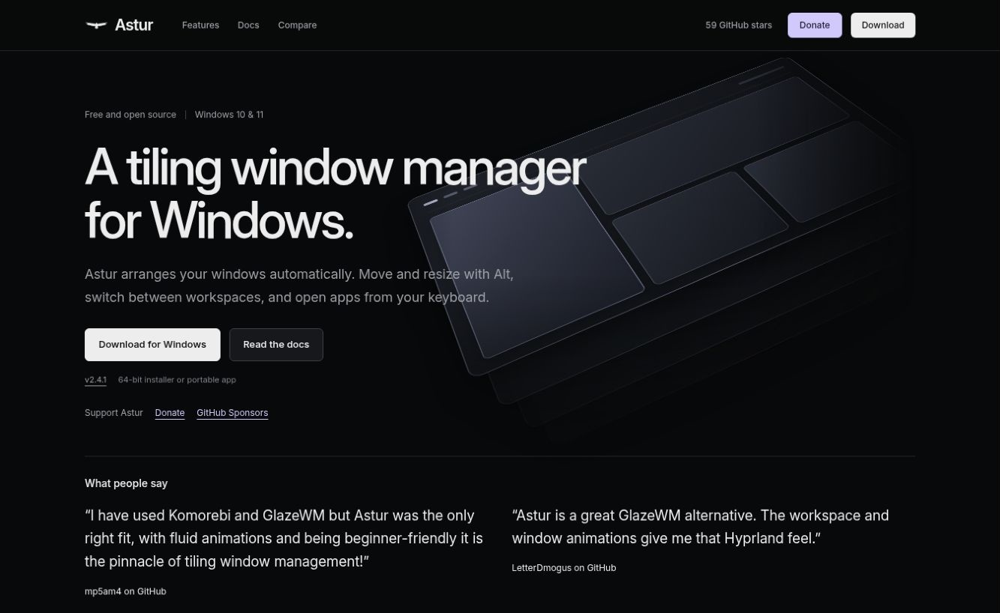

# Page011

### Trying to make Windows useable

I build desktop tools in Rust | from window management to everyday utilities.

[Astur](https://astur.app) · [Projects](https://github.com/Page011?tab=repositories) · [Sponsor](https://github.com/sponsors/Page011)

---

## Astur

**Hyprland for Windows! (almost)**

A free, open-source tiling window manager for Windows. Automatic layouts, smooth animations, virtual workspaces, and an app launcher.

**[Website](https://astur.app)** · **[Download](https://github.com/Page011/Astur/releases/latest)** · **[Source](https://github.com/Page011/Astur)** · **[Watch the demo](https://astur.app/#showcase)**

---

## More things I've built

| Project | What it does |
| :--- | :--- |
| **[Sill / crashpad](https://github.com/Page011/crashpad)** | A desktop island for clipboard history, notes, screenshots, reminders, and a file shelf. |
| **[Better Snip Tool](https://github.com/Page011/betterSnipTool)** | A worse snip tool but i wanted to try. |
| **[Vera Calendar](https://vera-calendar.com/)** | Outlook mail, calendar, tasks, and notes in one Windows app. |
| **[ChatCLI](https://github.com/Page011/chatCLI)** | Whatsapp and Microsoft Teams in a TUI so they stop hogging your RAM |
| **[WTGF](https://github.com/Page011/Windows-Terminal-Gap-Fix)** | A minimal rust script that fixes the gap between taskbar and terminal on Windows |

---

**Enjoy using my tools?**

[Star Astur](https://github.com/Page011/Astur) · [Report a bug](https://github.com/Page011/Astur/issues) · [Support my work](https://github.com/sponsors/Page011)

